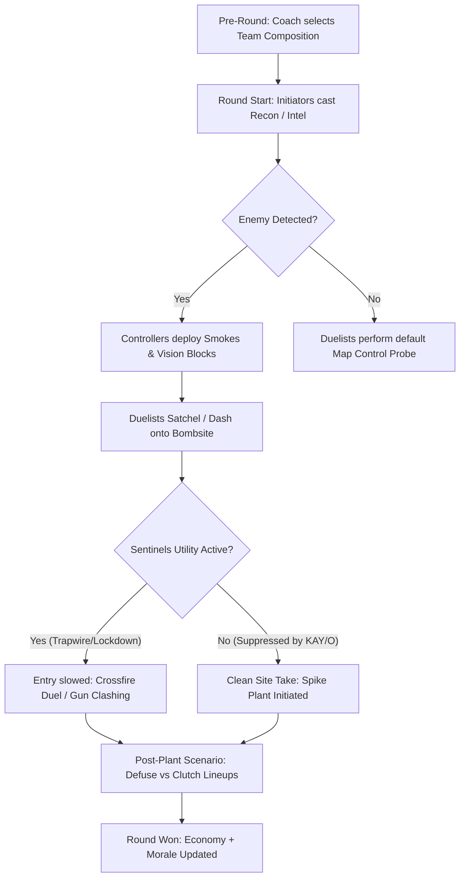

# VALORANT Agents Engine Guide & Tactical Simulation Matrix
**TACTIX: Pro Esports Manager — Engine Architecture Specification**  
*Source Research: Official Riot Games Valorant Agents Portal (`https://playvalorant.com/en-us/agents/`)*

---

## 1. Tactical Engine Overview & Agent Impact Formula

In **TACTIX**, a match round is not merely a random number generator; it is a simulated sequence of tactical decisions divided into four operational phases:
1. **Buy & Pre-Round Strategy (15s):** Economy management, default spreading, or set-piece execute calling.
2. **First Contact & Early Skirmish (100s - 75s):** Information gathering (Initiators), map denial (Controllers), entry duels (Duelists).
3. **Site Hit / Plant Phase (75s - 45s):** Smoke coverage, defensive stall, utility execution, and Spike placement.
4. **Post-Plant & Retake Phase (45s - 0s):** Crossfire setups, defuse delay lineups, clutch duels, and 1vX isolation.

### The Agent Combat Resolution Formula:
$$\text{Duel Advantage} = (\text{Aim} \times 0.40) + (\text{IQ} \times 0.25) + (\text{Utility Impact} \times 0.20) + (\text{Map Synergy} \times 0.15) \pm \text{Condition Modifiers}$$

Where **Utility Impact** is dynamically generated by active Agent abilities:
* **Flashes / Blinds:** Inflicts temporary $-35\%$ Aim penalty to defender for 1.5–2.5 seconds.
* **Smokes:** Nullifies long-range lines of sight (snipers forced to relocate or spam through smoke).
* **Concussion / Stun / Suppress:** Disables enemy abilities and reduces fire rate by $50\%$.
* **Recon / Intel:** Grants $100\%$ wallhack visibility to teammates, boosting first-bullet accuracy by $+25\%$.

---

## 2. DUELISTS (ตัวเปิดและตัวจบสกอร์ / Entry Fraggers & Duel Specialists)

> *"Duelists are self-sufficient fraggers who their team expects, through abilities and skills, to get first blood and create opening space on attack."*

| Agent | Country | Signature / Key Abilities | Engine Combat Role | Simulation Impact & Synergy |
| :--- | :--- | :--- | :--- | :--- |
| **Jett** | 🇰🇷 South Korea | **Tailwind** (Dash) **Cloudburst** (Instant Smoke) **Updraft** (Vertical jump) **Blade Storm** (Lethal Knives Ult) | Primary Entry & Sniper Escape | **Escape Pick:** Allows aggressive early peek with Operator; after taking a shot, instant dash prevents trade kill ($+40\%$ survivability). **Blade Storm:** $100\%$ accuracy during movement/jump. |
| **Raze** | 🇧🇷 Brazil | **Paint Shells** (Cluster Nade) **Blast Pack** (Satchel Mobility) **Boom Bot** (Intel/Chaser) **Showstopper** (Rocket Launcher Ult) | Area Clear & Chaos Entry | **Chokepoint Cleansing:** Forces Sentinels/anchors off common defense angles. **Showstopper:** High-probability multi-kill or guaranteed site push when enemies are grouped. |
| **Reyna** | 🇲🇽 Mexico | **Leer** (Nearsight Eye) **Devour** (Instant Overheal) **Dismiss** (Invulnerable Reposition) **Empress** (Raid Boss Buff Ult) | Snowball Duelist & 1vX Clutch Specialist | **1vX Multiplier:** When winning an opening duel, can Dismiss to safety or Overheal back to 150 HP, resetting fight conditions. In high morale, Clutch rating increases by $+30\%$. |
| **Phoenix** | 🇬🇧 United Kingdom | **Curveball** (Corner Flash) **Blaze** (Flame Wall) **Hot Hands** (Healing Molly) **Run It Back** (Clone Second Life Ult) | Self-Sustaining Entry | **Zero-Risk Site Scout:** **Run It Back** allows a free push onto site to gather exact enemy positions and get opening frags without risking player death. |
| **Yoru** | 🇯🇵 Japan | **Gatecrash** (Tether Teleport) **Blindside** (Bouncing Flash) **Fakeout** (Clone Decoy) **Dimensional Drift** (Invisibility Ult) | Mind Games & Deep Flanker | **Flank Distortion:** Teleports behind enemy lines during site hits, forcing defenders to split crosshair attention. Clone triggers enemy crosshairs and blinds opponents. |
| **Neon** | 🇵🇭 Philippines | **High Gear** (Sprint & Slide) **Relay Bolt** (Double Stun) **Fast Lane** (Dual Electric Walls) **Overdrive** (Lightning Beam Ult) | Rapid Rotate & Fast Site Hit | **Speed Blitz:** Fastest site execute in the game. Stuns defenders in tight corridors while sprint-sliding into site, creating chaos before defense can rotate. |
| **Iso** | 🇨🇳 China | **Double Tap** (Absorptive Energy Shield) **Undercut** (Through-wall Vulnerable) **Contingency** (Bulletproof Moving Wall) **Kill Contract** (1v1 Arena Ult) | Duel Protection & Isolation | **First Bullet Immunity:** Shield blocks one instance of lethal damage (even an Operator headshot). **Kill Contract:** Teleports high-value enemy (e.g. enemy star player) into an isolated 1v1 duel. |

---

## 3. INITIATORS (ผู้เปิดข้อมูลและทำลายจังหวะ / Info Gathering & Utility Clears)

> *"Initiators challenge angles by setting up their team to enter contested ground and push defenders away."*

| Agent | Country | Signature / Key Abilities | Engine Combat Role | Simulation Impact & Synergy |
| :--- | :--- | :--- | :--- | :--- |
| **Sova** | 🇷🇺 Russia | **Recon Bolt** (Sonar Intel Dart) **Shock Bolt** (Damage Lineups) **Owl Drone** (Dart Tagging Drone) **Hunter's Fury** (Piercing Bow Ult) | Wall-Piercing Intel & Post-Plant Denial | **Global Radar Tagging:** Reveals enemy dots on the 2D minimap for 3 seconds. **Hunter's Fury:** Fires through map terrain, deadly against Spike planters or defusers from complete safety. |
| **Fade** | 🇹🇷 Turkey | **Haunt** (Watcher Reveal Eye) **Seize** (Tether & Decay Orb) **Prowler** (Blind Chaser) **Nightfall** (Site-Wide Terror Trail Ult) | Aggressive Hunting & Trail Tracking | **Site Lockdown & Deafening:** Nightfall covers an entire bombsite, decaying enemy HP by 75 points and deafening them, guaranteeing easy cleanup for Duelists. |
| **Breach** | 🇸🇪 Sweden | **Flashpoint** (Through-Wall Flash) **Fault Line** (Seismic Tremor Stun) **Aftershock** (Lethal Wall Blast) **Rolling Thunder** (Massive Earthquake Ult) | Heavy Choke Disruption & Retake Master | **Through-Wall Warfare:** Punishes defenders hiding in corners behind impenetrable cover. Perfect synergy with Raze and Jett entries. |
| **Skye** | 🇦🇺 Australia | **Guiding Light** (Hawk Intel Flash) **Trailblazer** (Tasmanian Tiger Stun) **Regrowth** (Team Area Heal) **Seekers** (Tracking Cabbages Ult) | Team Flash & Support Scout | **Audio Feedback Flashes:** Confirms if enemies are blinded ("Blinded!"). Restores wounded teammates' HP to 100 before the final post-plant clash. |
| **KAY/O** | 🤖 Alternate Earth | **ZERO/POINT** (Suppression Knife) **FLASH/DRIVE** (Pop Flash) **FRAG/MENT** (Explosive Cluster) **NULL/cmd** (Pulsing Suppression Ult) | Anti-Ability Specialist & Reset Button | **Ability Blackout:** Shuts down enemy Sentinels (Killjoy/Cypher traps instantly deactivated). If downed during Ult, teammates can revive him. |
| **Gekko** | 🇺🇸 USA | **Dizzy** (Targeted Flash) **Wingman** (Autonomous Plant/Defuse) **Mosh Pit** (Lethal Fluid Zone) **Thrash** (Controllable Detain Ult) | Autonomous Objective & Reusable Pets | **5v5 Firepower Conservation:** Wingman plants/defuses the Spike automatically, freeing all 5 players to hold guns and cover crossfires. Reusable pets replenish after 10s cooldown. |
| **Tejo** | 🇨🇴 Colombia | **Tactical Intel & Zone Suppression** | Area Control & Tactical Lockdown | Modern 2026 Initiator designed to counter dense defensive setups. |

---

## 4. CONTROLLERS (ผู้ควบคุมวิสัยทัศน์ / Vision Denial & Smoke Screens)

> *"Controllers are experts in slicing up dangerous territory to set their team up for success."*

| Agent | Country | Signature / Key Abilities | Engine Combat Role | Simulation Impact & Synergy |
| :--- | :--- | :--- | :--- | :--- |
| **Omen** | 👤 Unknown | **Dark Cover** (Regenerating Smokes) **Paranoia** (Through-Wall Nearsight) **Shrouded Step** (Shadow Teleport) **From the Shadows** (Global Map Teleport) | Flexible Smoker & Mind Games | **Infinite Smoke Economy:** Smokes recharge every 30s. Can smoke any site from across the map. Paranoia covers entire corridors, blinding everyone caught in its wave. |
| **Brimstone** | 🇺🇸 USA | **Sky Smoke** (Triple Orbital Smokes) **Stim Beacon** (Rapid Fire Buff) **Incendiary** (Long Duration Molly) **Orbital Strike** (Lethal Laser Beam Ult) | Fast Execute & Post-Plant King | **Instant 3-Smoke Wall:** Drops 3 smokes simultaneously within 1 second for rapid site entries. **Orbital Strike:** Guaranteed round win if enemies attempt to defuse the Spike in overtime. |
| **Viper** | 🇺🇸 USA | **Toxic Screen** (Long Gas Wall) **Poison Cloud** (Gas Emitter) **Snake Bite** (Acid Vulnerability) **Viper's Pit** (Site-Swallowing Gas Ult) | Lurker Controller & Site Lockdown | **Decay Mechanic:** Any enemy crossing her wall suffers instant 30 HP decay. **Viper's Pit:** Virtually unretakeable when deployed on post-plant; reduces enemy sight and drains max HP to 1. |
| **Astra** | 🇬🇭 Ghana | **Astral Form** (Global Star Placement) **Gravity Well** (Pull & Vulnerable) **Nova Pulse** (Concuss) **Cosmic Divide** (Map-Splitting Sound Wall) | Global Strategic Mastermind | **Pure Macro Play:** Places stars anywhere on the map before or during the round. Cosmic Divide blocks bullets and muffles all audio across the entire map. |
| **Harbor** | 🇮🇳 India | **High Tide** (Steerable Water Wall) **Cove** (Bulletproof Water Shield) **Cascade** (Rolling Wave) **Reckoning** (Geyser Stun Ult) | Moving Execute & Bulletproof Planting | **Bulletproof Objective Shield:** Cove allows 100% safe Spike planting or defusing under sniper fire. Geysers flush out enemies from concealed cubbies. |
| **Clove** | 🏴󠁧󠁢󠁳󠁣󠁴󠁿 Scotland | **Ruse** (Post-Death Smokes!) **Meddle** (Decay Core) **Pick-Me-Up** (Speed & Overheal) **Not Dead Yet** (Self-Revive Ult) | Aggressive Duelist-Controller Hybrid | **Post-Mortem Dominance:** Can drop smokes even after being eliminated! Can self-revive after death if getting a frag or assist within 12 seconds. |
| **Miks** | 🇪🇸 Spain | **Aerosol & Toxic Filtration** | Tactical Sightline Blocking | 2026 Controller specialist designed for high-density maps like Summit and Corrode. |

---

## 5. SENTINELS (แนวรับป้องกันและเฝ้าหลัง / Defensive Anchors & Site Lockdown)

> *"Sentinels are defensive experts who can lock down areas and watch flanks, both on attacker and defender rounds."*

| Agent | Country | Signature / Key Abilities | Engine Combat Role | Simulation Impact & Synergy |
| :--- | :--- | :--- | :--- | :--- |
| **Killjoy** | 🇩🇪 Germany | **Turret** (Automated Sentry Gun) **Alarmbot** (Vulnerable Detonator) **Nanoswarm** (Concealed Grenades) **Lockdown** (Site Detain Device Ult) | Passive Defense & Retake Deterrent | **Autonomous Multi-Angle Defense:** Turret tags enemies, reducing their movement speed; Nanoswarms activate on Spike to delay defusal for 9+ seconds. **Lockdown:** Forces full enemy evacuation. |
| **Cypher** | 🇲🇦 Morocco | **Trapwire** (Invisible Tether Trips) **Spycam** (Dart-Shooting Camera) **Cyber Cage** (Audible Smoke Cage) **Neural Theft** (Global Enemy Reveal Ult) | Zero-Gap Flank Watch & Intel Master | **Impenetrable Flank:** Trapwires prevent enemies from flanking attackers undetected. **Neural Theft:** Uses a fresh corpse to instantly reveal all living enemies on the radar. |
| **Sage** | 🇨🇳 China | **Barrier Orb** (Fortified Wall) **Slow Orb** (Ice Slit Slow) **Healing Orb** (Direct Ally/Self Heal) **Resurrection** (Full Teammate Revive Ult) | Stall Anchor & Life Restorer | **Tempo Reset:** Fortified wall completely seals a choke point, burning 30+ seconds off the clock. **Resurrection:** Turns a 4v5 into a 5v5, tilting statistical round win rate by $+38\%$. |
| **Chamber** | 🇫🇷 France | **Trademark** (Slow Trap) **Headhunter** (Heavy Pistol with ADS) **Rendezvous** (Instant Teleport Anchor) **Tour De Force** (One-Shot Sniper Ult) | Fragging Sentinel & Sniper Specialist | **Aggressive Anchor:** Can hold off-angles with Tour De Force and teleport back to safety immediately on firing. Saves team economy with lethal pocket weapons. |
| **Deadlock** | 🇳🇴 Norway | **GravNet** (Crouch-Forcing Net) **Sonic Sensor** (Sound-Triggered Concuss) **Barrier Mesh** (4-Quadrant Glass Wall) **Annihilation** (Cocoon Capture Ult) | Anti-Rush & Space Denial | **Rush Killer:** Sonic Sensors punish running duelists. **Annihilation:** Shoots a nanowire pulse that cocoons an enemy and drags them to death unless teammates shoot them free. |
| **Vyse** | 🇷🇸 Serbia | **Shear** (Isolating Metal Trap Wall) **Arc Rose** (Wall-Embedded Flash) **Razorvine** (Wounding Vine Clustered Slow) **Steel Garden** (Primary Weapon Jammer Ult) | Entry Duelist Isolation & Gun Lock | **Anti-Duelist Specialist:** **Shear** wall rises behind the first attacker, isolating them from their team. **Steel Garden:** Jams all primary guns (Vandals/Phantoms disabled for 8s), forcing pistol combat! |
| **Veto** | 🇬🇷 Greece | **Fortification & Tactical Suppression** | Heavy Defense Anchor | 2026 Sentinel specialized in counter-execute setups. |

---

## 6. How TACTIX Simulates Agent Dynamics in 2D Match Engine

When you run a match between two teams in TACTIX (e.g. **FULL SENSE vs Paper Rex** on Ascent):

1. **Composition Balance Check:** If a team has no Controller, their long-range death rate jumps by $+35\%$ due to unblocked sniper sightlines.
2. **First Blood Attribution:** High-rated Duelists like `Primmie` or `something` with Jett/Reyna have a $+25\%$ First Frag probability.
3. **Clutch Probability:** Players with high Clutch stat holding Sentinel or Controller roles have enhanced survivability and post-plant stall capabilities.
4. **Killfeed Integration:** Every kill properly identifies whether it was a gunfight (`Vandal`, `Phantom`) or an agent ability (`Showstopper`, `Shock Bolt`, `Blade Storm`), rendering the exact official Riot Games silhouette icon in real-time!
